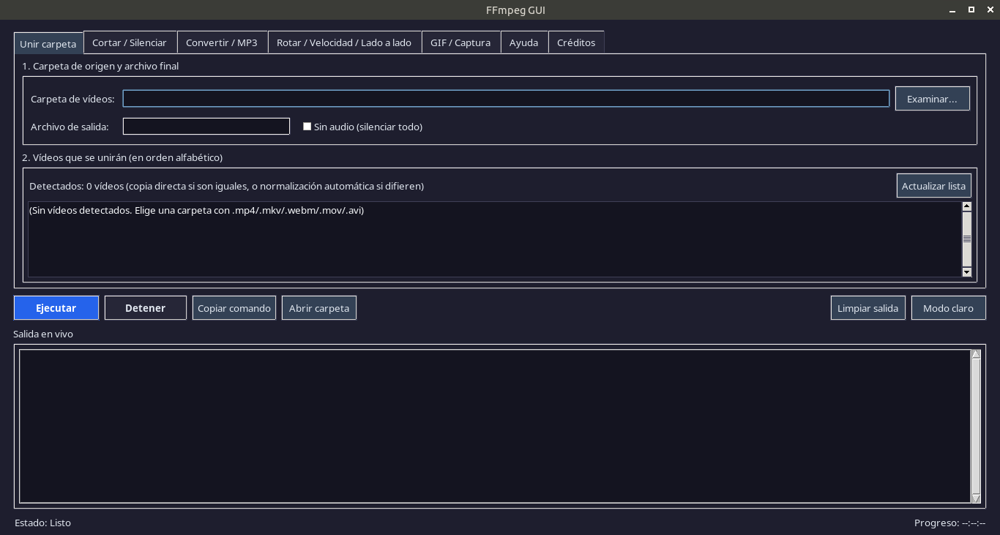

# FFmpeg GUI

Interfaz gráfica ligera en Python y Tkinter para usar [`ffmpeg`](https://ffmpeg.org/) en Linux sin depender de frameworks pesados.



## Características
- Sin dependencias externas (solo Python 3, Tkinter y `ffmpeg`).
- Modo oscuro y claro.
- **Unir carpeta:** lista previa en orden alfabético (`.mp4`, `.mkv`, `.webm`, `.mov`, `.avi`, `.m4v`), opción *Sin audio*, copia directa cuando los clips coinciden o normalización automática si difieren en resolución/FPS.
- **Cortar / Silenciar:** recorte por rango (`Inicio` → `Fin`) en modo rápido (*Copy*) o exacto, más botón de **silenciar vídeo completo en 1 clic**.
- **Convertir / MP3:** convierte a `.mp4`, `.mkv`, `.webm` o extrae audio `.mp3`, con selector de resolución (`Original`, `1080p`, `720p`, `480p`) y compresión (`CRF 20 / 23 / 27`).
- **Rotar / Velocidad / Lado a lado:** rotar 90°/180°/espejo, cambiar velocidad (`0.5x`–`2x`), reemplazar pista de audio o emparejar 2 vídeos lado a lado.
- **GIF / Captura:** crear GIF animado optimizado de un clip corto o extraer una foto `.jpg` de un segundo concreto.
- Consola en vivo, progreso en tiempo real, botón **Copiar comando** y ejecución en Linux con `nice(10)` para no saturar el escritorio.
- Guarda únicamente sus preferencias en `~/.config/ffmpeg-gui.json`, sin modificar configuraciones globales del sistema.

## Requisitos (Linux)
- `python3` y `python3-tk`
- `ffmpeg` y `ffprobe` instalados en el `PATH`

En Debian / Ubuntu / antiX:
```bash
sudo apt install python3-tk ffmpeg
```

## Instalación
```bash
git clone https://github.com/KennyWaddell/ffmpeg-gui.git
cd ffmpeg-gui
chmod +x install.sh
./install.sh
```

Para abrirla, búscala en el menú (**FFmpeg GUI**) o ejecuta:
```bash
ffmpeg-gui
```

## Desinstalación
```bash
./uninstall.sh
```

## Créditos
Hecha por **Kenny Waddell**.

## Licencia
GNU GPLv3. Ver [LICENSE](LICENSE).
